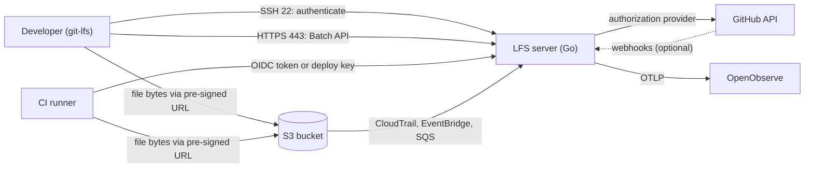
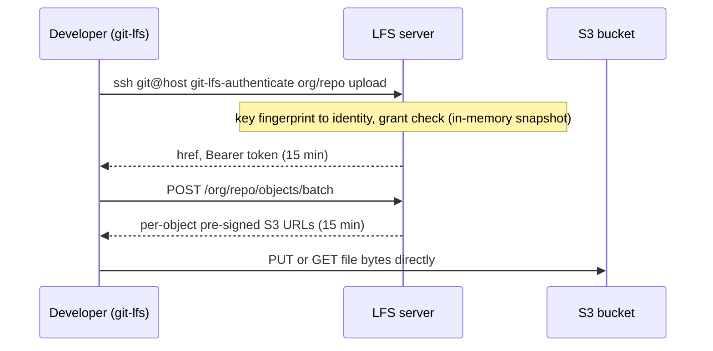

# naraen

A self-hosted Git LFS server that keeps code on GitHub but stores large files in Amazon S3. Developers authenticate with the SSH keys they already use for GitHub, GitHub decides what they may access, and file bytes go directly between the client and S3, so the server itself only handles small control requests.

> **Status:** scaffold. The request-path building blocks (path normalization, OID validation, tokens, datastore, authorization, SSH key callback, Batch parsing, OIDC claim checks, webhook verification) are implemented and tested. S3 presigning, the GitHub provider's network sync and the Batch handler are not yet wired up.

## Goals

- Move 1 TB+ of LFS assets, mostly short-lived feature-branch files, off GitHub's metered LFS storage.
- No new credentials for developers: their existing GitHub SSH key is their identity, and GitHub is the source of truth for access.
- CI pipelines can download without a GitHub seat.
- Treat the stored files as critical intellectual property: least privilege, full audit trail, usage metrics and anomaly alerts, and exhaustive testing.

**Non-goals:** HTTPS username/password/token sign-in for developers, the LFS locks API, and carrying file bytes through the server.

## Architecture

A single Go binary runs an SSH listener (port 22) and an HTTPS listener (port 443). Files live in one S3 bucket, with one top-level folder per repo.

## Authentication and authorization

- **Developers** are identified by the SHA-256 fingerprint of their SSH public key, resolved against an in-memory datastore. The SSH layer never contacts GitHub.
- **CI** uses either GitHub Actions OIDC (verified against a registered workload-trust entry, read-only, no secrets) or a repo deploy key.
- **Authorization** is split in two halves that never call each other. The *request path* (SSH, token issuance, Batch API) only reads an immutable datastore snapshot and fails closed. A pluggable *provider* (GitHub first) keeps the datastore populated. The linter enforces that request-path packages cannot import `internal/provider`.
- Tokens are HMAC-SHA256 signed, bound to a repo ID and operation, and live 15 minutes. Every Batch request re-checks the token's identity and grant against the current snapshot, so revocations apply to new links at once.
- Only organisation members and deploy keys can authenticate. Outside collaborators are given no access, because the provider loads SSH keys only for org members.

## Security

| Threat | Control |
| --- | --- |
| SSH sign-in bypass (CVE-2024-45337) | `golang.org/x/crypto` >= 0.31.0 enforced by a test; identity taken only from the callback's returned permissions |
| Wrong-repo access | Strict path normalization, resolution to repo ID, tokens bound to repo and operation, OID validation |
| Stale access | Periodic full sync, tokens re-checked against the current snapshot on every request, requests refused when the snapshot exceeds its maximum age |
| Provider bug | Snapshots validated before swap; unusual drops, additions or level raises rejected until an operator approves; webhook deltas can only remove access |
| Leaked URL | 15-minute expiry; full URLs never logged |
| Man in the middle | TLS 1.3 minimum; modern-only SSH KEX, ciphers and MACs |

## Testing and quality gates

All security gates are blocking in CI.

| Area | Tools |
| --- | --- |
| Unit and race | `go test -race -shuffle=on`; 100% line coverage (go-test-coverage) and 100% branch coverage (gobco) required |
| Fuzzing | Go native fuzzing on every client-input parser |
| Mutation | gremlins, every mutant must be killed (100% line coverage already covers every mutant in code) |
| SAST | gosec, CodeQL (`security-extended`), Semgrep with custom rules, golangci-lint, nilaway |
| SCA | govulncheck, OSV-Scanner, Dependabot, dependency review |
| Secrets | gitleaks |
| Container | Trivy, hadolint; distroless nonroot runtime image |
| DAST | ZAP (API and baseline), Nuclei, testssl.sh, ssh-audit |
| Supply chain | OpenSSF Scorecard, actions pinned by SHA, cosign, SBOM via goreleaser |

## Development

Everything runs in a container; no host Go toolchain is required.

1. Open the repo in VS Code and choose **Reopen in Container** (builds the `dev` stage of the `Dockerfile`), or build it yourself: `docker build --target dev -t naraen-dev .`
2. Run tasks with [go-task](https://taskfile.dev): `task --list`.

| Task | Purpose |
| --- | --- |
| `task check` | Fast gate: format, tidy, lint, nilaway, coverage, vuln, SAST, secrets |
| `task ci` | `check` plus fuzz, mutation, integration, image scan and DAST |
| `task test`, `task cover` | Unit tests, line and branch coverage gates |
| `task fuzz`, `task mutation` | Fuzzing (`FUZZTIME=5m`) and mutation testing |
| `task integration` | Real git/git-lfs against the server with a local S3 (`docker compose up -d s3`) |
| `task image`, `task scan`, `task dast` | Build the runtime image, scan it, run DAST |

Configuration is by environment variable. Secrets are never put in the environment, only the paths of the files that hold them:

- `NARAEN_TOKEN_KEYS_FILE`: one `<id> <hex>` token key per line, at least 32 bytes each. The first line mints; later lines only verify, so a rotated key stays listed until its tokens expire.
- `NARAEN_SSH_HOST_KEY_FILE`: the SSH host private key.
- `NARAEN_TLS_CERT_FILE` and `NARAEN_TLS_KEY_FILE`: the TLS certificate and key.
- `NARAEN_DEV=true`: allow any of the above to be missing and use ephemeral key material instead. Without it the server refuses to start unless all are set.
- `NARAEN_SSH_CONN_BURST` and `NARAEN_SSH_CONN_INTERVAL`: the per-source SSH connection rate limit, by default a burst of 20 and then one connection per 200ms. A source is an IPv4 address or an IPv6 /64. Raise them where many clients share one address, such as an office NAT or CI egress.
- `NARAEN_SSH_ADDR`, `NARAEN_HTTPS_ADDR`, `NARAEN_SNAPSHOT_FILE`, `NARAEN_SNAPSHOT_MAX_AGE`.

## Known limitations

- Plain S3 egress roughly matches GitHub's bandwidth price; savings come mainly from storage.
- A pre-signed PUT is limited to 5 GB; Git LFS basic transfer has no multipart support.
- Every LFS operation depends on one instance.
- Access removed on GitHub stops new links only at the next full sync (up to about 15 minutes; webhooks shorten this). Links already issued stay valid for up to 15 minutes more, and S3 checks a link only when a transfer starts, so a transfer already running finishes. The worst case from revocation to the last byte is therefore about 30 minutes plus the length of one transfer.
- Change limits on full syncs mean a large real change (a reorg, a mass offboarding) is held back until an operator approves it; if nobody does, the snapshot goes stale and the server refuses all requests.

## License

GNU Affero General Public License v3.0. See [LICENSE](LICENSE).
