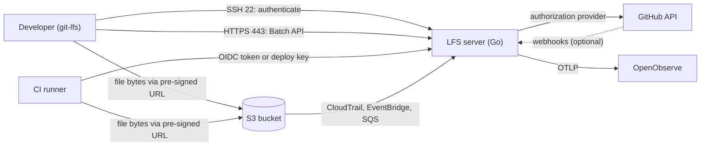
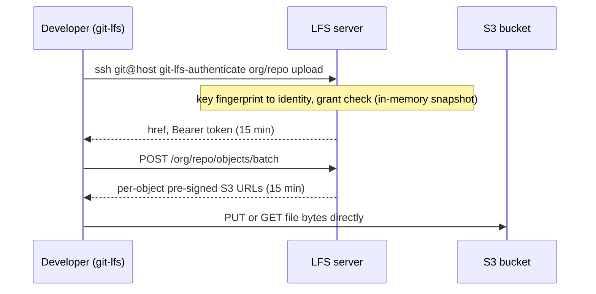

# naraen

A self-hosted Git LFS server that keeps code on GitHub but stores large files in Amazon S3. Developers authenticate with the SSH keys they already use for GitHub, GitHub decides what they may access, and file bytes go directly between the client and S3, so the server itself only handles small control requests.

> **Status:** early. `git lfs push` and `git lfs pull` work end to end over SSH authentication, the Batch API and pre-signed S3 URLs that bind each upload to its SHA-256 and size. CI workloads exchange an OIDC token for a read-only LFS token at `/{owner}/{repo}/ci/token`. Signed GitHub webhooks for removed members, removed collaborators and deleted deploy keys revoke access at once. The GitHub provider syncs members, their SSH keys, collaborators, deploy keys and the Actions OIDC keys through a GitHub App. The per-person download budget is not built yet.

## Goals

- Move 1 TB+ of LFS assets, mostly short-lived feature-branch files, off GitHub's metered LFS storage.
- No new credentials for developers: their existing GitHub SSH key is their identity, and GitHub is the source of truth for access.
- CI pipelines can download without a GitHub seat.
- Treat the stored files as critical intellectual property: least privilege, full audit trail, usage metrics and anomaly alerts, and exhaustive testing.

**Non-goals:** HTTPS username/password/token sign-in for developers, the LFS locks API, and carrying file bytes through the server.

## Architecture

A single Go binary runs an SSH listener (port 22) and an HTTPS listener (port 443). Files live in one S3 bucket, with one top-level folder per repo.





## Authentication and authorization

- **Developers** are identified by the SHA-256 fingerprint of their SSH public key, resolved against an in-memory datastore. The SSH layer never contacts GitHub.
- **CI** uses either GitHub Actions OIDC (verified against a registered workload-trust entry, read-only, no secrets) or a repo deploy key.
- **Authorization** is split in two halves that never call each other. The *request path* (SSH, token issuance, Batch API) only reads an immutable datastore snapshot and fails closed. A pluggable *provider* (GitHub first) keeps the datastore populated. The linter enforces that request-path packages cannot import `internal/provider`.
- Tokens are HMAC-SHA256 signed, bound to a repo ID and operation, and live 15 minutes. Every Batch request re-checks the token's identity and grant against the current snapshot, so revocations apply to new links at once.
- Only organisation members and deploy keys can authenticate. Outside collaborators are given no access, because the provider loads SSH keys only for org members.

## Security

| Threat | Control |
| --- | --- |
| SSH sign-in bypass (CVE-2024-45337) | `golang.org/x/crypto` >= 0.31.0 enforced by a test; identity taken only from the callback's returned permissions |
| Wrong-repo access | Strict path normalization, resolution to repo ID, tokens bound to repo and operation, OID validation |
| Stale access | Periodic full sync, tokens re-checked against the current snapshot on every request, requests refused when the snapshot exceeds its maximum age |
| Provider bug | Snapshots validated before swap; unusual drops, additions or level raises rejected until an operator approves; webhook deltas can only remove access |
| Leaked URL | 15-minute expiry; full URLs and tokens never logged (a Semgrep rule with its own test cases) |
| Unattributed access | An audit record for every sign-in, refusal and token issued, with identity, key fingerprint, remote address and reason; each token carries an ID that ties later requests to its issue. Refusals and issues are also OTLP metrics for real-time alerts, and every request is a trace naming the same identity, token ID and reason |
| Man in the middle | TLS 1.3 minimum; modern-only SSH KEX, ciphers and MACs |

## Testing and quality gates

All security gates are blocking in CI.

| Area | Tools |
| --- | --- |
| Unit and race | `go test -race -shuffle=on`; 100% line coverage (go-test-coverage) and 100% branch coverage (gobco) required |
| Fuzzing | Go native fuzzing on every client-input parser |
| Mutation | gremlins, every mutant must be killed (100% line coverage already covers every mutant in code) |
| SAST | gosec, CodeQL (`security-extended`), Semgrep with custom rules, golangci-lint, nilaway |
| SCA | govulncheck, OSV-Scanner, Dependabot, dependency review |
| Secrets | gitleaks |
| Container | Trivy, hadolint; distroless nonroot runtime image |
| DAST | ZAP (API scan authenticated with a dev LFS token, a dev OIDC token and webhook deliveries signed with the dev secret, and baseline), Nuclei, testssl.sh, ssh-audit |
| Supply chain | OpenSSF Scorecard, actions pinned by SHA; releases only from main after every gate passes; static-PIE binaries and a multi-arch image, both signed with cosign, with SBOMs and GitHub build provenance |

## Development

Everything runs in a container; no host Go toolchain is required.

1. Open the repo in VS Code and choose **Reopen in Container**. The devcontainer is the `dev` service of `docker-compose.yml`, and it starts the whole local stack with it (below). Without VS Code, `docker compose run --rm dev task <name>` runs a task in the same container.
2. Run tasks with [go-task](https://taskfile.dev): `task --list`.

| Task | Purpose |
| --- | --- |
| `task check` | Fast gate: format, tidy, lint, nilaway, coverage, vuln, SAST, secrets |
| `task ci` | `check` plus fuzz, mutation, integration, image scan and DAST |
| `task test`, `task cover` | Unit tests, line and branch coverage gates (`task cover-lines`, `task cover-branches`) |
| `task fuzz`, `task mutation` | Fuzzing (`FUZZTIME=5m`) and mutation testing |
| `task integration` | The access matrix with real git, git-lfs and OpenSSH against the built server and a signature-checking local S3 (`docker compose run --rm s3-init`, or the running stack), plus upload-integrity checks of the signed links |
| `task smoke` | The walkthrough below, against the running compose stack |
| `task image`, `task scan`, `task dast` | Build the runtime image, scan it, run DAST |
| `task build`, `task release-check` | Release binaries for this platform, or validate the release config and build every target, in `dist/` |

### Try it locally

`docker compose up -d` (or opening the devcontainer) starts a working server with storage, and a container to use it from. On the compose network each service is reached by name:

- `s3`: SeaweedFS on `http://s3:8333`, checking signatures, with the bucket `naraen-dev` created.
- `naraen`: the server in development mode, with SSH on `naraen:2222` and the Batch API on `https://naraen:8443`. It loads `test/testdata/snapshot.json`, which accepts the two committed development keys in `test/testdata/devkeys/`: `writer` may upload and download `example/repo`, and `reader` may only download. Its SSH host key and TLS certificate are committed beside them. All of these are public on purpose, and the server refuses them outside development mode.
- `oidc`: a development OIDC issuer on `http://oidc:8080` that stands in for GitHub Actions (`cmd/naraen-dev-oidc`). It signs ES256 tokens with GitHub's claims and a committed key, and the dev snapshot trusts that key for the audience `naraen-dev`, with a CI workload holding read access to `example/repo`. The server refuses that trust outside development mode.
- `client`: a developer's machine with git, git-lfs, ssh and curl. It holds the dev keys (`writer` by default), and trusts the server's host key and certificate.

A pre-signed link names the S3 host it was signed for, and the Batch API's address is the server's name. So every client must resolve `naraen` and `s3` (and `oidc`, to play a CI job), and every container on the compose network does.

Work as a developer from the client. Repositories carry the LFS address in a committed `.lfsconfig`:

```sh
docker compose exec client bash
git init demo && cd demo
git config -f .lfsconfig lfs.url ssh://git@naraen:2222/example/repo
git lfs track '*.psd'
head -c 1000000 /dev/urandom > art.psd
git add . && git commit -m 'Add art'
git init --bare ~/origin.git && git remote add origin ~/origin.git
git push origin main             # uploads art.psd through the server to S3
cd .. && git clone ~/origin.git copy   # downloads it again
```

A CI job has no SSH key. It gets an OIDC token from the issuer and exchanges it for a read-only LFS token, as a GitHub Actions job would:

```sh
oidc=$(curl -fsS 'http://oidc:8080/token?audience=naraen-dev&repository_id=1&repository=example/repo' | sed -E 's/.*"value":"([^"]+)".*/\1/')
curl -fsS -X POST -H "Authorization: Bearer $oidc" https://naraen:8443/example/repo/ci/token
# {"href":"https://naraen:8443/example/repo","header":{"Authorization":"Bearer v1.dev...."},"expires_in":900}
git -c lfs.url=https://naraen:8443/example/repo -c "http.extraHeader=Authorization: Bearer v1.dev...." lfs pull
```

`scripts/smoke.sh` does the same as a check, and adds that `reader` and the CI job may not push. Run it in the client (`docker compose exec client naraen-smoke`) or in the devcontainer (`task smoke`). DAST runs it before scanning.

Nothing in the stack is bind-mounted from the repository. Its configuration reaches the containers through image builds and SeaweedFS's own shell, and `task dast` streams each tool's inputs in and copies its reports out. So compose and DAST behave the same from the devcontainer, which runs them against the host's Docker, as from the host.

To use the stack from the host instead, where compose publishes the ports on `127.0.0.1`, add `127.0.0.1 naraen s3 oidc` to the hosts file (`C:\Windows\System32\drivers\etc\hosts` on Windows). Then set up a repository the way the client image is set up: trust the host key (`[naraen]:2222` plus the key in `ssh_host_ed25519_key.pub`) and the certificate (`git config http.sslCAInfo`), and use the `writer` key with mode 600. On Windows, also set `git config http.sslBackend openssl`, because git-lfs ignores `sslCAInfo` under the default schannel backend, and give `sslCAInfo` a `C:/...` path, because git-lfs cannot read Git Bash's `/c/...` form.

### Configuration

Configuration is by environment variable. Secrets are never put in the environment, only the paths of the files that hold them:

- `NARAEN_TOKEN_KEYS_FILE`: one `<id> <hex>` token key per line, at least 32 bytes each. The first line mints; later lines only verify, so a rotated key stays listed until its tokens expire.
- `NARAEN_SSH_HOST_KEY_FILE`: the SSH host private key.
- `NARAEN_TLS_CERT_FILE` and `NARAEN_TLS_KEY_FILE`: the TLS certificate and key.
- `NARAEN_PUBLIC_URL`: the HTTPS origin clients reach the Batch API at, such as `https://lfs.example.com`. `git-lfs-authenticate` returns it with the repo path appended. Only an origin is accepted: no path, query, fragment or userinfo.
- `NARAEN_OTLP_ENDPOINT`: the OTLP/HTTP base URL, such as `https://openobserve.internal:5080/api/default`. Metrics go to `/v1/metrics` under it, pushed every 15 seconds; spans go to `/v1/traces` and log records to `/v1/logs`, in batches, and log records to stdout as well. All three are flushed on shutdown. Every call is traced, none sampled away: each HTTPS request (except the health probes), each SSH connection with a span per command, each Batch object with its S3 request, and each provider sync with its GitHub requests. Log records made during a request carry its trace: `trace_id` and `span_id` on stdout, the record's own trace fields over OTLP. Trace context is neither read from clients nor sent to GitHub or S3. Optional; without it nothing is exported, logs go to stdout only, and a warning is logged at startup. It must be https, except to a loopback address.
- `NARAEN_OTLP_HEADERS_FILE`: optional, one `Name: value` header per line sent with every export, typically the ingestion credential.
- `NARAEN_S3_BUCKET`: the bucket holding every repo's objects, each repo under a top-level folder named by its ID, so lifecycle rules, replication and audit selectors can address a repo by prefix. The name is an S3 name without dots, so virtual-hosted TLS works.
- `NARAEN_S3_ENDPOINT`: optional; replaces the AWS S3 endpoint, with path-style addressing, for S3-compatible storage such as SeaweedFS. It must be https, except to a loopback address, or to any address in development mode.
- `AWS_REGION` and the AWS SDK's default credential chain: the instance role on EC2, or a shared credentials file named by `AWS_SHARED_CREDENTIALS_FILE` elsewhere. The region must be set; the signer needs `s3:GetObject` and `s3:PutObject` on the objects and `s3:ListBucket` on the bucket. Without the last, S3 answers 403 instead of 404 for a missing object, and uploads of new objects fail. The server never lists the bucket, but a compromised one could, so log `ListObjects` as a CloudTrail data event and alert on any call from its role.
- `NARAEN_GITHUB_ORG`, `NARAEN_GITHUB_APP_ID`, `NARAEN_GITHUB_INSTALLATION_ID` and `NARAEN_GITHUB_APP_KEY_FILE` (the App's PEM private key): the GitHub provider, all four or none. It runs a full sync at startup and every `NARAEN_SYNC_INTERVAL` (default `15m`, at least `1m`). With a bucket and configured token keys, each change to the datastore is also saved to `access-permissions-snapshot.json` at the bucket's root, signed with the token keys, and a new server restores it at startup if it verifies and is within `NARAEN_SNAPSHOT_MAX_AGE`, so a restart while GitHub is unreachable keeps serving until that age. Otherwise the server is not ready until the first sync succeeds. It is an alternative to `NARAEN_SNAPSHOT_FILE`. The App needs read access to members, metadata and administration (for deploy keys).
- `NARAEN_OIDC_AUDIENCE`: optional; the custom audience CI jobs request GitHub Actions OIDC tokens for. With it, each sync registers Actions as a trusted issuer with its current keys, and every repo gets a CI workload with read access.
- `NARAEN_GITHUB_API_URL` and `NARAEN_GITHUB_JWKS_URL`: overrides for GitHub Enterprise and tests; https, except to a loopback address.
- `NARAEN_GITHUB_WEBHOOK_SECRET_FILE`: optional, the secret GitHub signs webhook deliveries with (at least 20 bytes). With it, `/webhooks/github` applies removals at once; without it the route is not served and removals wait for the next full sync. The development secret in `test/testdata/devkeys` is refused outside development mode.
- `NARAEN_DEV=true`: allow any of the above to be missing and use ephemeral key material instead, with the public URL defaulting to `https://localhost:<HTTPS port>`. Without a bucket the Batch API answers 503. Without it the server refuses to start unless the token keys, host key, TLS files, public URL and bucket are all set. A snapshot file that lists the public development keys is refused unless `NARAEN_DEV=true`.
- `NARAEN_SSH_CONN_BURST` and `NARAEN_SSH_CONN_INTERVAL`: the per-source SSH connection rate limit, by default a burst of 20 and then one connection per 200ms. A source is an IPv4 address or an IPv6 /64. Raise them where many clients share one address, such as an office NAT or CI egress.
- `NARAEN_SSH_ADDR`, `NARAEN_HTTPS_ADDR`, `NARAEN_SNAPSHOT_FILE`, `NARAEN_SNAPSHOT_MAX_AGE`.

## Known limitations

- Plain S3 egress roughly matches GitHub's bandwidth price; savings come mainly from storage.
- A pre-signed PUT is limited to 5 GB; Git LFS basic transfer has no multipart support.
- Every LFS operation depends on one instance.
- Access removed on GitHub stops new links only at the next full sync (up to about 15 minutes; webhooks shorten this). Links already issued stay valid for up to 15 minutes more, and S3 checks a link only when a transfer starts, so a transfer already running finishes. The worst case from revocation to the last byte is therefore about 30 minutes plus the length of one transfer.
- Change limits on full syncs mean a large real change (a reorg, a mass offboarding) is held back until an operator approves it; if nobody does, the snapshot goes stale and the server refuses all requests.

## License

GNU Affero General Public License v3.0. See [LICENSE](LICENSE).
