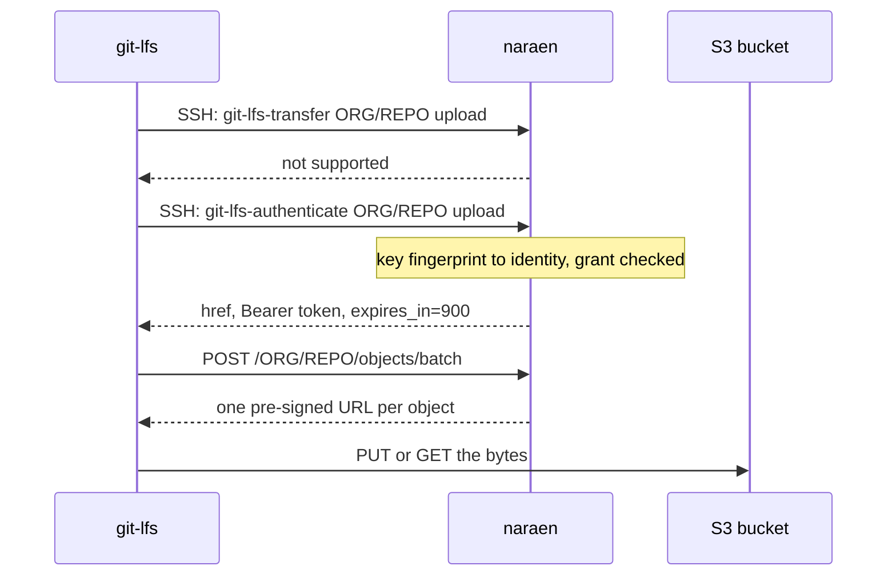

A push or pull involves three parties: the Git LFS client, the naraen server, and S3. The server authorizes and the client transfers.

## 1. The refused shortcut

Git LFS tries `git-lfs-transfer` first. The server refuses it, because accepting would send every byte through the server. The client then falls back to `git-lfs-authenticate`.

## 2. Authentication over SSH

The SSH layer looks up the fingerprint of the offered key in the datastore. During the handshake a client offers its keys in turn, and the first one that is found is accepted. The server then resolves the repository path to a repository ID and checks that the identity's grant allows the operation: `read` for a download, `write` for an upload.

If it does, the server mints a bearer token bound to the repository ID and the operation, valid for 15 minutes, and prints it with the Batch API address. Git LFS keeps the token in memory and repeats the SSH step when it expires, so developers never see or store it.

## 3. The Batch request

The client posts the objects it wants to move. For every request the server verifies the token's signature and expiry, checks that it is for the repository in the URL and for the operation requested, and checks the grant again against the current snapshot. Revoking access therefore takes effect on the next Batch request, even for a token not yet expired.

Each object ID must be exactly 64 lowercase hexadecimal characters before it is used in a storage key.

## 4. Pre-signed URLs

For each object the server asks S3 whether it is stored, then signs a URL valid for 15 minutes.

- A **download** of a stored object gets a GET URL. A missing object, or one whose stored size differs from the request, is reported as an error for that object.
- An **upload** of an object already stored gets no action, so the client skips it and an existing object is never replaced.
- An **upload** of a new object gets a PUT URL that signs the SHA-256 of the object, which is its ID, and its content length. S3 rejects bytes that do not match, so nobody can store different content under an ID.

S3 checks a URL's signature when a request starts, so a large transfer that begins in time completes.

## 5. The bytes

The client sends or fetches the bytes directly. The URL carries an opaque `x-lfs-req` query parameter. S3 ignores it but records it in access logs, which links each transfer to the request that authorized it.
